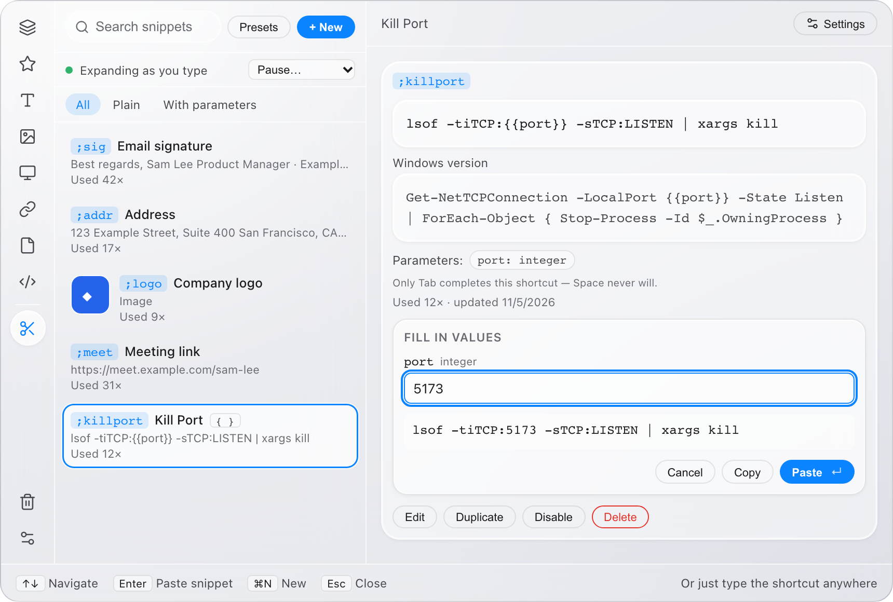
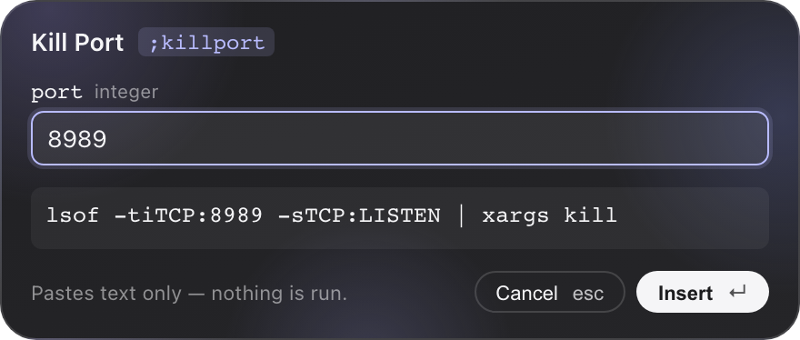

# Clipet

A fast, private clipboard manager and screenshot tool for macOS and Windows.
Clipet remembers what you copy (text, links, code, images, screenshots and real
files), lets you find it again in a keystroke, and pastes it back into the app
you were using. Everything stays on your computer.

Built with Tauri 2 (Rust) + React/TypeScript + SQLite.


## Features

**Clipboard history**
- Press **⌘⇧V** (Ctrl+Shift+V on Windows) anywhere to open the popup, pick an item with the arrow keys and press **Enter**. Clipet hands focus back to the exact window you came from and pastes there.
- Text, links, code, images, screenshots and **files and folders** are all recorded, sorted into categories, and can be favorited or pinned.
- A slim icon sidebar switches categories; hover over an icon (or tab to it) to see its name and item count.
- Select several items (Shift / ⌘-click) to paste them in order, or several images to paste them as one batch.
- The popup can be dragged by its sidebar, search bar, header or shortcut bar, and it stays on screen.

**Light and dark glass themes**


- Frosted-glass panels in two looks: **Light**, in the style of macOS Control Center (gray glass, white rims, system blue), and **Dark**, charcoal with soft lavender glows.
- Choose Light, Dark or System (follows your OS) in **Settings → Appearance**. The look is the same on any wallpaper, and text stays easy to read. If your OS asks apps to reduce transparency, Clipet switches to solid panels.

**Search that reads your images**
- Search matches text *inside* screenshots and images, read on-device by Apple Vision (macOS) or Windows OCR, and matches are highlighted on the image. The recognition language can be changed in Settings.
- Partial-word search, case- and space-insensitive matching, and exact matches ranked first.

**Real files, not just their names**


- Copying files in Finder or Explorer records the actual file references (in order, including folders and non-Latin names), never the file contents.
- **Paste File** pastes the files themselves into any app that accepts files. You can also **Copy Path**, **Copy File Link** (`file://`, properly encoded), **Reveal in Finder / Show in Explorer**, or **Open**.
- Moved, renamed or deleted files and disconnected drives are flagged instead of failing silently.

**Long text, comfortably**


- Long text and code get a short preview and an **Expand** button. The viewer has find with highlights and next/previous, line wrapping, Copy All, editing, and character and line counts. The history list stays usable next to it.

**Smart Snippets**


- Type a shortcut such as `;sig` followed by Space or Tab in any app, and it expands into saved text or an image.
- Each snippet chooses what follows the text: nothing (the default), one space, or a new line. The key you press to expand is never inserted.
- **Presets:** an optional starter set (Kill Port, Localhost URL, Docker Logs, Git Commit, SSH, email and meeting messages, and more). Adding one never replaces a snippet you already have.
- **Back up:** export your snippets to a file and import them on another computer. Anything that can't be imported is listed with the reason.
- Snippets are stored separately from history, so clearing history never removes them.

**Snippets with values**



- Write `{{port}}` (any name) in a snippet and it becomes a fill-in value. Clipet spots the placeholders as you type and lets you choose each one's type: text, whole number (with min/max), URL, date, or a list of choices. A live preview shows the exact result.
- **Inline:** type `;killport 5173` then **Tab** and the finished command is inserted in one go. Quote values with spaces: `;hello "Sam Lee" Clipet`.
- **Ask me:** type just `;killport` then **Tab** (or give a value that isn't valid) and a small window asks for it:

  

  Press **Enter** to insert or **Esc** to cancel. Your typed shortcut is left untouched until you confirm. Clipet only inserts once it has confirmed you're back in the same app and text field; if it can't confirm that, it inserts nothing and tells you why.
- **Per-OS versions:** a snippet can have its own macOS, Windows and Linux text (for example, `lsof` on macOS and PowerShell on Windows). The right one is used automatically.
- Only Tab completes a snippet with values, so typing a shortcut word followed by Space in normal sentences never triggers one.
- **Clipet only ever inserts text. It never runs a command**, even when the text is one.

**Annotate screenshots**


- Hover over an image and click **Edit**: pen, highlighter, arrows, shapes, text, blur, pixelate, crop, undo/redo and zoom.
- **Save as New** (the default; the original is untouched), **Replace Original**, or **Save & Paste**.

**Settings, privacy and housekeeping**


- One Settings window (the gear at the bottom of the sidebar) holds the theme, text-in-images search and its language, history cleanup, recording pause and Clear All History.
- Copies that password managers mark as private are never recorded. Recording can be paused for 15 minutes, an hour, or until you resume.
- Optional automatic cleanup: keep history forever (the default), or for 1, 7, 30 or 90 days, or a custom number of days. Favorites, pinned items and snippets are protected, and Clipet shows how many items a setting would delete before it deletes anything.
- No accounts, no cloud, no telemetry. Text recognition runs on-device, and snippet values are never logged.

## Install

Builds are written to `release/` (not committed to git, see [Development](#development) to build them):

| Platform | File |
|---|---|
| macOS (Apple Silicon and Intel) | `Clipet_0.1.0_universal.dmg` |
| Windows x64 | `Clipet_0.1.0_x64-setup.exe` |

**macOS:** open the DMG and drag Clipet to Applications. To paste and expand snippets, Clipet needs
**System Settings → Privacy & Security → Accessibility** turned on for Clipet. It asks the first time.
When updating, quit Clipet from its menu-bar icon first, then replace it; if pasting stops working
afterwards, turn Clipet's Accessibility switch off and on again.

**Windows:** run the installer. It isn't code-signed yet, so Windows may show "Windows protected your PC";
choose **More info → Run anyway**.

> The macOS build is signed for local use but not notarized. The Windows build is cross-compiled
> from macOS and hasn't yet been tested on a Windows PC.

## Good to know

- **Password fields:** while a password field has focus, macOS hides typing from every app, so snippets
  can't expand there. Clipet respects that and doesn't work around it. To insert a snippet into a password
  field, open Clipet (⌘⇧V) → **Snippets** → **Enter**. If a browser leaves its password field
  focused in the background, typing stays hidden everywhere. Leave that field or restart the
  browser, and the Snippets view will tell you which app is blocking it.
- **Snippets with values from Clipet's window:** selecting one and pressing **Enter** (or **Fill in & paste…**) asks for its values first; a raw `{{…}}` template is never pasted.
- **Typed snippet expansion** is built for macOS and Windows. The Windows version hasn't been tried on a Windows PC yet, and Windows has no way for Clipet to detect password fields.
- **Logs** (no clipboard content, typed text or snippet values are ever logged): `~/Library/Logs/com.clipflow.app/snippets.log`. Lines starting with `prompt:` explain what the fill-in window did.

## Development

Requirements: Node 20+, Rust (stable), and the Tauri 2 prerequisites for your OS.

```sh
cd app
npm install
npm run tauri dev          # run with hot reload
```

| Command (in `app/`) | What it does |
|---|---|
| `npm run tauri:build:mac` | Signed universal macOS `.app` + `.dmg` (requires a signing identity) |
| `npm run tauri build -- --runner cargo-xwin --target x86_64-pc-windows-msvc --bundles nsis` | Windows installer, cross-compiled from macOS (needs `cargo-xwin`, `nsis`, `llvm` on PATH) |
| `cd src-tauri && cargo test` | Rust unit and integration tests |
| `npm run test:ui` | Headless UI regression tests (Playwright, mocked Tauri bridge) |
| `npm run screenshots` | Regenerates the README screenshots from sample data |

On macOS, a development build inherits Accessibility permission from the app that launched it (VS Code, Terminal or iTerm), so enable that app under Accessibility if paste is blocked.

### Project layout

```
app/
  src/                 React UI: popup (App.tsx), Snippets, fill-in window (PromptWindow), Editor,
                       FileCard, TextViewer, HistorySettings, presets, shared Tooltip / SearchField / ParamForm
  src-tauri/src/
    lib.rs             Tauri commands, paste pipeline, tray, window handling
    clipboard.rs       Clipboard monitor: text, images, file references, private-copy detection
    db.rs              SQLite history store, migrations, retention cleanup
    paste_target.rs    macOS: return focus to the exact window and send ⌘V
    snippets/          Text expander: engine, parameters, store, fill-in popup, import/export, macOS/Windows keyboard hooks
    ocr/               On-device text recognition (Vision / Windows OCR), benchmark
    retention.rs       Automatic history cleanup
  tests/               UI regression tests
  scripts/             Build and screenshot scripts
docs/
  ARCHITECTURE.md      Design and data flow
  PROGRESS.md          Detailed change log, verification notes and known gaps
  factory/             Status of the UI redesign and snippets-with-values work (progress.md)
  screenshots/         Images used in this README
release/               Built installers
```

## Status

Clipet 0.1.0 is in active development. See [docs/PROGRESS.md](docs/PROGRESS.md) and
[docs/factory/progress.md](docs/factory/progress.md) for what was verified on which platform and
what is still pending.
